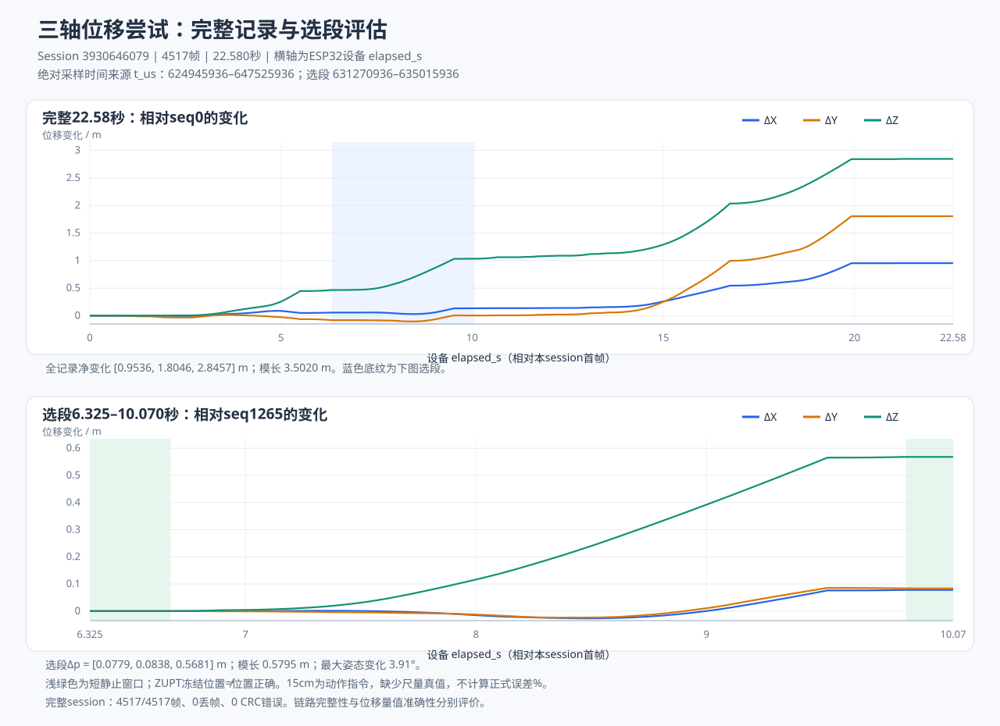

# 三轴位移尝试评估

本次记录来自 session `3930646079`，共 **4517 帧、22.580 秒**。完整数据保存在 `recording.json` 与 `data.csv`；下述范围仅用于展示，不删改样本，不重算或截短原 END。

## 展示范围与可复查数值

| 范围 | 帧序号（含两端） | ESP32 采样时间 t_us | 位置变化 ΔX / ΔY / ΔZ（米） | 变化模长 |
|---|---|---|---|---|
| 全记录 | 0–4516 | 624945936–647525936 | 0.953609 / 1.804586 / 2.845738 | 3.502017 m |
| 平移尝试选段 | 1265–2014 | 631270936–635015936 | 0.077931 / 0.083819 / 0.568077 | 0.579491 m |

选段设备时间为 **6.325–10.070 秒**，持续3.745秒。前静止窗口为6.325–6.675秒（seq1265–1335），后静止窗口为9.865–10.070秒（seq1973–2014），两窗口均连续带有固件 stationary 标记。选段中四元数相对起点的最大姿态变化为 **3.91°**，属于姿态变化较小的位移尝试；仍含瞬时角速度变化，不能认定严格纯平移。

选段的估计变化约 **0.5795米**，主要为Z方向 **0.5681米**。所选范围依据前后短暂静止及姿态相对稳定确定，没有按数值接近15厘米来选择。

## 图的计算口径

图的横轴使用设备 `elapsed_s=(t_us-624945936)/1e6`。上图显示全记录 `p(t)-p(seq0)`，下图显示选段 `p(t)-p(seq1265)`；减去起点仅用于展示相对变化，原始存储位置、序号、采样时间与END均未修改。下图浅绿色区域表示上述两个短静止窗口。最大姿态变化按 `2*acos(abs(q(t)·q_start))` 计算，并对反三角函数输入作数值范围限制。

## 能说明什么

- “移动15厘米”是动作指令，并非本记录配套的尺量或同步位置真值。因此不计算正式位移误差百分比，也不将本次结果认定为精度达标；约0.58米的选段结果与15厘米指令明显不一致。
- 前后静止时位置曲线冻结，说明ZUPT将速度置零并保留当前位置。**位置停止变化不等于累计位置正确**，冻结保留了此前的积分误差。
- 加速度偏置、单姿态比例校准的局限、姿态误差造成的重力泄漏、动作中的小幅转动及静止判定均可能影响二次积分。仅凭本记录不能确诊哪一项为主要原因。
- 链路完整性与位置数值准确性分别评价。本session的END为generated=4517、sent=4517，接收4517个唯一帧，丢帧0、CRC错误0、采样失败0；这些结果支持本段传输完整，不能证明位移量值准确。
- 本导出记录相邻 `t_us` 均为5000微秒，按导出值如实报告；不据此推断独立硬件时钟的精度。

本节适合作为“三轴位移功能已运行、短时动作响应可观察、累计误差仍明显”的局限性展示。若需评价15厘米动作的真实精度，需另行取得固定轴向、明确起止位置和同步尺量基准的数据。
